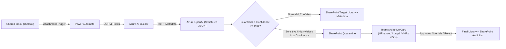

# Intelligent Document Pipeline

[](https://github.com/Sev-AS/intelligent-document-pipeline/actions/workflows/ci.yml)


[](LICENSE)

Automated email document intake, classification, SharePoint routing, and human-in-the-loop Microsoft Teams escalation built with **Power Automate**, **Azure AI Builder**, and **Azure OpenAI**.

Built for a common operations bottleneck: invoices, NDAs, HR forms, and vendor certificates arriving in a shared inbox had to be opened, read, renamed, and filed manually. This pipeline extracts text/fields with **Azure AI Builder**, classifies documents into a strict JSON schema with **Azure OpenAI**, applies deterministic compliance guardrails, files routine documents into **SharePoint** with populated metadata, and holds sensitive, high-value, or low-confidence cases in Quarantine while alerting the right team in **Microsoft Teams** with an interactive Adaptive Card.

---

## Architecture



### Routing & Escalation Policy

| Document Type | SharePoint Destination | Auto-Route? | Escalation Channel |
| :--- | :--- | :---: | :--- |
| Standard Invoice (`< $10,000`) | `/RoutedDocuments/Finance/Invoices` | Yes | `#Finance-Approvals` |
| High-Value Invoice (`>= $10,000`) | Quarantine → Finance after approval | Escalated | `#Finance-Approvals` |
| Legal Contract / NDA | Quarantine → Legal after approval | Escalated | `#Legal-Review` |
| HR / Onboarding / PII | Quarantine → HR Restricted after approval | Escalated | `#People-Ops-Private` |
| Vendor Compliance (COI, W-9) | `/RoutedDocuments/Procurement/Compliance` | Yes | `#Procurement-Ops` |
| Low-Confidence / Blurry Scan | Quarantine → Ops triage | Escalated | `#Document-Triage-Ops` |

---

## What Is Inside This Repository

This repository contains both the **Microsoft 365 / Azure deployment artifacts** and a **locally runnable reference engine + simulator** so anyone can inspect, test, and verify the routing behavior on Linux, macOS, or Windows without needing an active Azure subscription.

```text
intelligent-document-pipeline/
├── power-automate/
│   ├── flows/
│   │   ├── email-document-router.json      # Main Power Automate WDL flow (Outlook -> AI Builder -> Azure OpenAI -> SharePoint/Teams)
│   │   └── teams-approval-callback.json    # Human decision callback flow (Approve/Override/Reject + Audit Log)
│   ├── adaptive-cards/
│   │   ├── escalation-review-card.json     # Interactive Teams Adaptive Card v1.5 for human review
│   │   └── daily-exception-summary.json    # Daily digest card
│   └── prompts/
│       ├── classification-system.txt       # Grounded taxonomy & sensitivity system prompt
│       └── classification-schema.json      # JSON Schema enforced via Azure OpenAI Structured Outputs
├── sharepoint/
│   ├── site-schema.json                    # SharePoint Site Script (libraries, metadata columns & audit list)
│   └── routing-rules.json                  # Declarative routing matrix & retention labels
├── infra/
│   ├── main.bicep                          # Azure Bicep IaC (Azure OpenAI, Key Vault RBAC, App Insights)
│   └── parameters.example.json
├── src/doc_router/                         # Runnable Python engine / optional Power Automate Custom Connector
│   ├── classifier.py                       # Azure OpenAI client + deterministic PII/sensitivity guardrails + offline mode
│   ├── router.py                           # Policy evaluator, SharePoint metadata builder & Adaptive Card renderer
│   ├── main.py                             # FastAPI service (/health, /api/v1/classify-and-route)
│   ├── config.py
│   └── models.py
├── samples/emails/                         # 5 synthetic sample attachments (zero real PII or company data)
├── scripts/run_local_pipeline.py           # Zero-cost CLI simulator running all 5 scenarios end-to-end
├── tests/                                  # Unit tests for guardrails, Azure OpenAI parsing, routing & API
├── docs/
│   ├── architecture.md                     # Design rationale & failure handling
│   ├── deployment-guide.md                 # Step-by-step Azure + M365 setup
│   └── governance-and-security.md          # Data residency, Managed Identity, Quarantine & audit trail
├── Dockerfile
├── docker-compose.yml
└── Makefile
```

---

## Try It Locally (No Azure Subscription Required)

The repository ships with **zero secrets and zero real data**. Everything can be tested locally on **Linux, macOS, or Windows**.

### Option 1 — Run the local CLI pipeline simulator

```bash
git clone https://github.com/Sev-AS/intelligent-document-pipeline.git
cd intelligent-document-pipeline
pip install -r requirements.txt

# Linux / macOS
PYTHONPATH=src python3 scripts/run_local_pipeline.py

# Windows PowerShell
$env:PYTHONPATH="src"; python scripts/run_local_pipeline.py
```

Add `--dump-cards` to print the full hydrated **Microsoft Teams Adaptive Card v1.5 JSON** for every escalated document (pasteable directly into [Adaptive Cards Designer](https://adaptivecards.io/designer/)).

Sample output:

```text
[AUTO-ROUTE]  INV-4082_Northwind_Supplies.pdf
              category=invoice confidence=0.95 sensitivity=normal
              -> SharePoint: /RoutedDocuments/Finance/Invoices/INV-4082_Northwind_Supplies.pdf (label: Financial-7Years)

[ESCALATED]   CI-9914_Annual_Renewal.pdf
              category=invoice confidence=0.95 sensitivity=normal
              -> Quarantine: /DocumentIntakeQuarantine/PendingReview/CI-9914_Annual_Renewal.pdf
              -> Teams Channel: #Finance-Approvals
              -> Reasons: high_value_invoice:18,450.00>=10,000.00

[ESCALATED]   Meridian_Mutual_NDA_v2_Redline.pdf
              category=legal_contract confidence=0.94 sensitivity=confidential
              -> Quarantine: /DocumentIntakeQuarantine/PendingReview/Meridian_Mutual_NDA_v2_Redline.pdf
              -> Teams Channel: #Legal-Review
              -> Reasons: sensitivity:confidential, category_policy:legal_contract, policy:nda_or_legal, policy:confidential_marking

[ESCALATED]   Onboarding_Payroll_Form.pdf
              category=hr_document confidence=0.93 sensitivity=restricted
              -> Quarantine: /DocumentIntakeQuarantine/PendingReview/Onboarding_Payroll_Form.pdf
              -> Teams Channel: #People-Ops-Private
              -> Reasons: sensitivity:restricted, category_policy:hr_document, pii:ssn_pattern, pii:bank_routing, policy:hr_sensitive

[ESCALATED]   IMG_4482_scan.jpg
              category=general confidence=0.58 sensitivity=normal
              -> Quarantine: /DocumentIntakeQuarantine/PendingReview/IMG_4482_scan.jpg
              -> Teams Channel: #Document-Triage-Ops
              -> Reasons: low_confidence:0.58<0.85, quality:low_ocr_readability

Summary: 1 auto-routed to SharePoint, 4 escalated to Teams.
```

### Option 2 — Run the containerized API (Power Automate Custom Connector)

```bash
cp .env.example .env
docker compose up --build -d
```

- **Swagger UI:** `http://127.0.0.1:8000/docs`
- To connect live Azure OpenAI instead of offline mode, set `AZURE_OPENAI_ENDPOINT` and `AZURE_OPENAI_API_KEY` in `.env`.
- To access the API from other devices on your local network, set `BIND_HOST=0.0.0.0` in `.env`.

---

## Deploying to Azure & Microsoft 365

See [docs/deployment-guide.md](docs/deployment-guide.md) for the complete walkthrough:
1. Deploy Azure OpenAI + Key Vault + App Insights via `infra/main.bicep`.
2. Provision SharePoint libraries & custom metadata columns via `sharepoint/site-schema.json`.
3. Import `power-automate/flows/*.json` and wire Connection References + Teams Adaptive Cards.

Additional documentation:
- [docs/architecture.md](docs/architecture.md)
- [docs/governance-and-security.md](docs/governance-and-security.md)

---

## Validation & Tests

```bash
make validate   # Validates docker-compose.yml and all Power Automate / SharePoint / Bicep / sample JSON files
make lint       # Runs Ruff across src/, tests/, and scripts/
make test       # Runs the full unit test suite (11 tests)
make simulate   # Runs the offline triage pipeline on samples/emails/
```

---

## Author

**Sebastian Montoya Ochoa** — [@Sev-AS](https://github.com/Sev-AS)

## License

[MIT](LICENSE)
