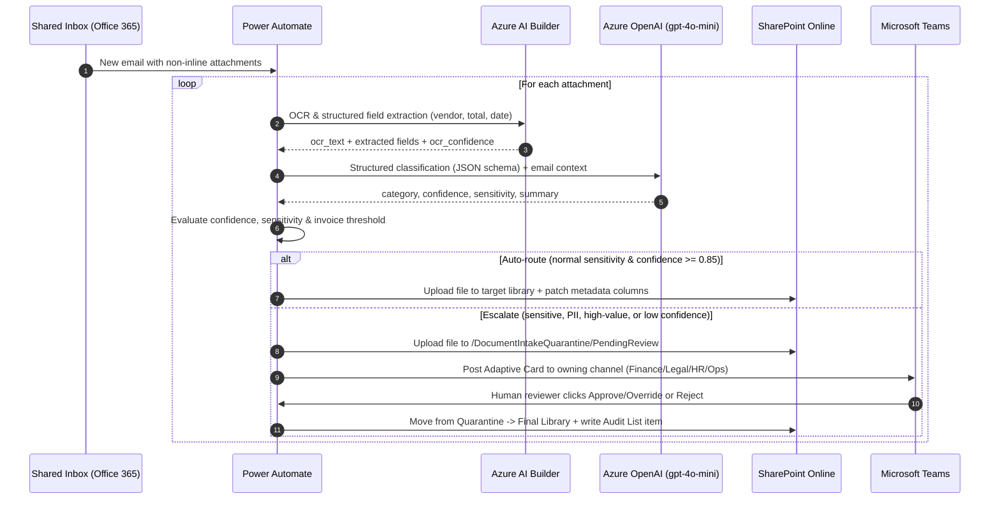

# Architecture Notes

## End-to-End Processing Flow

## Why Combine AI Builder and Azure OpenAI?

Using only one tool leaves clear gaps in real email intake:

- **Azure AI Builder (Document Processing / OCR)** handles messy scanned PDFs, rotated photos, and invoice field extraction reliably, which raw chat models struggle with when fed raw bytes.
- **Azure OpenAI (`gpt-4o-mini` with Structured Outputs)** understands *both* the email body and the OCR text together—so it can distinguish a vendor invoice from a legal dispute mentioning an invoice amount, summarize the file for a human reviewer, and return strict schema-validated JSON.

## Defense-in-Depth Guardrails

An LLM should never be the sole gatekeeper for sensitive or high-value documents. The routing logic enforces deterministic guardrails on top of model output:

1. **Confidence floor (`CONFIDENCE_THRESHOLD`, default `0.85`):** Any uncertain classification or unreadable scan (`ocr_confidence < 0.70`) is held in Quarantine for human triage.
2. **Sensitivity floor (cannot be downgraded):** Deterministic regex checks flag SSNs, bank routing/direct deposit forms, NDA/litigation terms, and HR payroll records. Even if the LLM returns `sensitivity: "normal"`, the guardrail forces `confidential` or `restricted`.
3. **Category policy (`sharepoint/routing-rules.json`):** `legal_contract` and `hr_document` always require human sign-off in their respective private Teams channels (`#Legal-Review`, `#People-Ops-Private`).
4. **Financial threshold:** Invoices at or above `HIGH_VALUE_INVOICE_THRESHOLD` (default `10,000`) automatically route through `#Finance-Approvals`.
5. **Fail-safe degradation:** If Azure OpenAI times out or errors, the pipeline does not silently misfile documents—it lowers confidence below threshold and routes to Quarantine for manual handling.

## Why Include `src/doc_router` Alongside Power Automate Flows?

Power Automate flows are notoriously hard to regression-test inside the browser designer. Including the reference Python engine (`src/doc_router`) serves two practical purposes:

- **Offline testing & prompt regression:** Run `scripts/run_local_pipeline.py` and unit tests in CI before changing thresholds, routing rules, or prompts in production.
- **Optional Custom Connector / Azure Container App:** Teams that outgrow Power Automate expression syntax can host `src/doc_router` as a single HTTP action called from the flow, keeping routing logic version-controlled and unit-tested.
